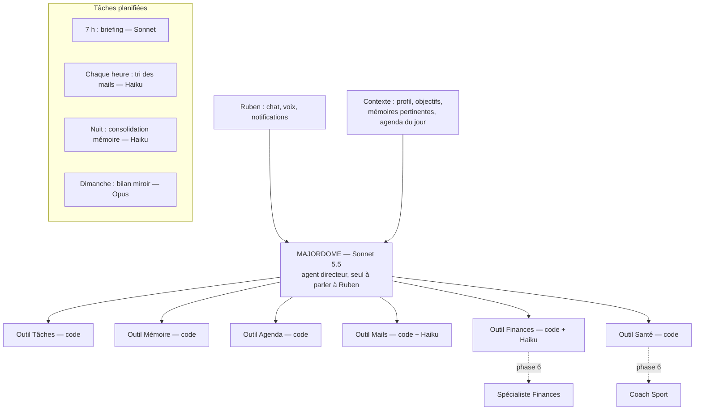

# Architecture IA de Majordome

## 4 niveaux de « cerveau » — on descend toujours au plus bas qui suffit

| Niveau | Quoi | Modèle | Exemples |
|---|---|---|---|
| 0 | Code classique | — | rappels à heure fixe, totaux, dates, SQL |
| 1 | Petites tâches répétitives | `claude-haiku-5-5` | trier un mail, catégoriser une dépense, extraire une tâche |
| 2 | Le Majordome (conversation, planification) | `claude-sonnet-5-5` | chat, briefing, plan de la journée |
| 3 | Réflexion rare et profonde | `claude-opus-5-5` | bilan « miroir » hebdomadaire |

Prix et identifiants : `src/lib/models.ts`. Tout appel passe par `src/lib/ai.ts` → journalisé dans `ai_calls`.

## Hiérarchie

## Principes
1. **Un seul agent parle à Ruben.** Les autres capacités sont des outils. Un seul endroit à déboguer.
2. **Multi-agents progressif.** Phases 1 à 5 : outils simples. Phase 6 : certains outils deviennent des « spécialistes » (un appel modèle avec un prompt dédié), dirigés par le Majordome. Pas de refonte nécessaire.
3. **La mémoire est le cœur.** À chaque message, le Majordome ne reçoit que le contexte pertinent. La nuit, Haiku fusionne les doublons et retire le périmé.
4. **Lecture seule** sur les données externes, et confirmation explicite avant toute action irréversible.
